# Чёрный Ворон · редактор уровней

**Рисуйте свои уровни для «Чёрного Ворона» прямо в браузере.** «Чёрный Ворон» — стратегия в реальном времени для ZX Spectrum 128K
(Copper Feet, 1997–98). Редактор показывает карту, здания и героев той же графикой, что и в игре. Готовый уровень пишется в формате игры
байт в байт, и его можно сразу собрать в образ диска и запустить в эмуляторе.

Ничего не нужно ставить: это одна страница HTML. Откройте её — и можно рисовать. Файлы игры не нужны: десять уровней
«Чёрного Ворона» встроены в редактор (кнопка «Уровни игры…»), любой можно открыть и взять за основу своего.
Интерфейс — на русском и английском (переключатель RU / EN вверху справа).
Нет идеи для карты — кнопка «Сгенерировать…» сделает заготовку: поле боя, крепость или подземелье в стиле карт автора.

**▶ Открыть онлайн: https://marginal2k.github.io/br1_zx/**

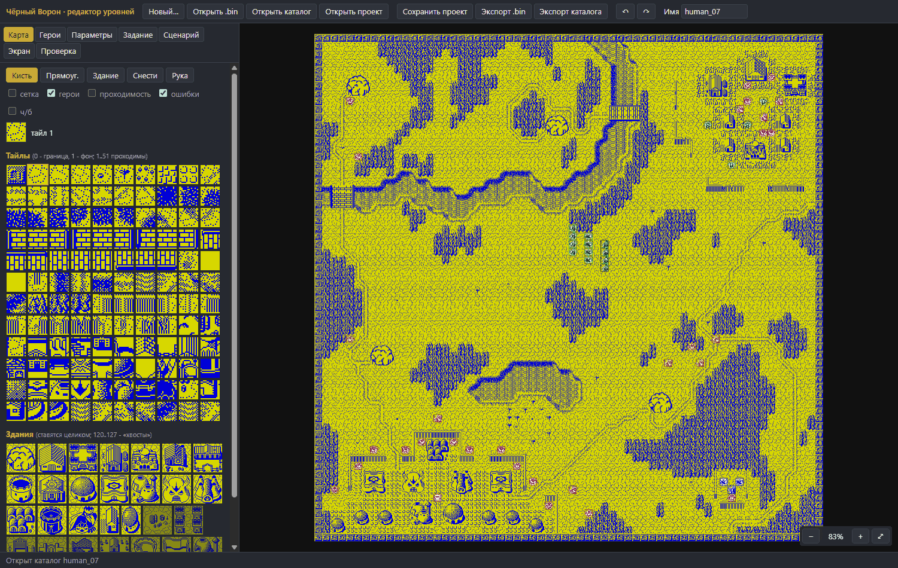

## Что можно делать

| | |
|---|---|
| 🗺️ **Рисовать карту 64×64** тайлами любого из четырёх ландшафтов, в цветах уровня. Есть кисть, прямоугольник, пипетка, масштаб колесом, сдвиг мышью и отмена. | 🏰 **Ставить здания целиком.** Редактор сам расставляет все клетки здания (3×3 или 2×2) и следит, чтобы никакое здание не осталось сломанным. |
| ⚔️ **Расставлять героев** — их 27 видов: от крестьян до некромантов, пауков и демонов. Каждый нарисован своим спрайтом из игры, а рамка показывает сторону: свои, враги или пленники. | ⚙️ **Задавать параметры уровня**: деньги, лес, золото в шахтах, мелодию, вооружение и заклинания обеих сторон, поведение компьютера. |
| 📜 **Писать задание** шрифтом игры: живой предпросмотр, счётчик знаков и подсказка, если какой-то буквы в шрифте нет. | 🧩 **Брать сценарий** (условия победы и события) из уровней игры: основных 1997 г. и дополнительных 1999 г. Код можно посмотреть дизассемблированным. |
| 🖼️ **Менять заставку**: подходит `.scr` или PNG, а цвета редактор приведёт к спектрумовским. | ✅ **Проверять уровень на ходу**: границу, здания, число героев, проходимость клеток, длину задания. Щелчок по ошибке показывает её место на карте. |
| 🎲 **Генерировать заготовки**: поле боя с базами, шахтами и преградами, крепость, подземелье с камерами и туннелем. Тайлы ставятся только так, как их ставил автор. | ⏮️ **Листать варианты**: зерно, «◀ ▶» по последним вариантам; замена уровня — одно действие, которое отменяется Ctrl+Z. |
| 🛣️ **Рисовать дороги и реки одним движением**: повороты, развилки, берега и мосты редактор подбирает сам, по картам автора. Река шириной 3, 4 или 5 клеток. | 🌲 **Рисовать покрытием**: лес, площади баз, а в подземелье скалу, стену и пол — края с соседями подбираются сами. «Перерисовать» обновляет тайлы в рамке. |

<table>
<tr><td>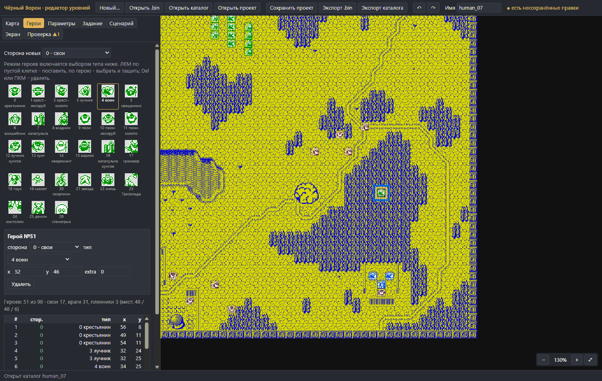</td><td>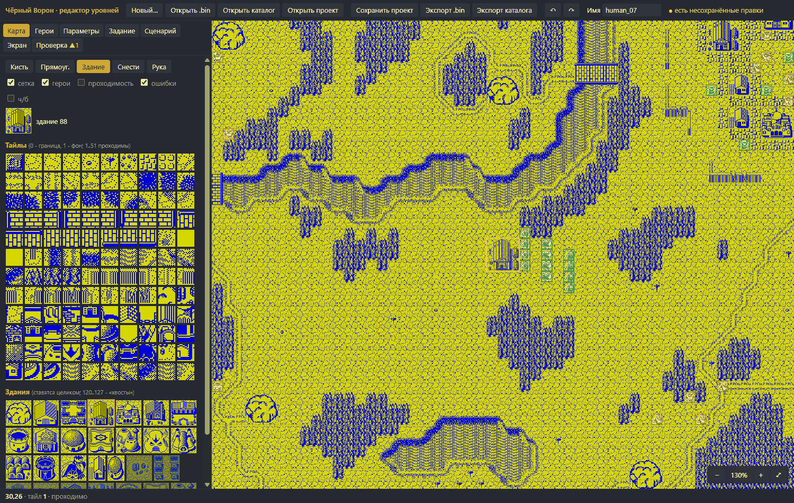</td></tr>
<tr><td align="center">Герои</td><td align="center">Здания</td></tr>
<tr><td>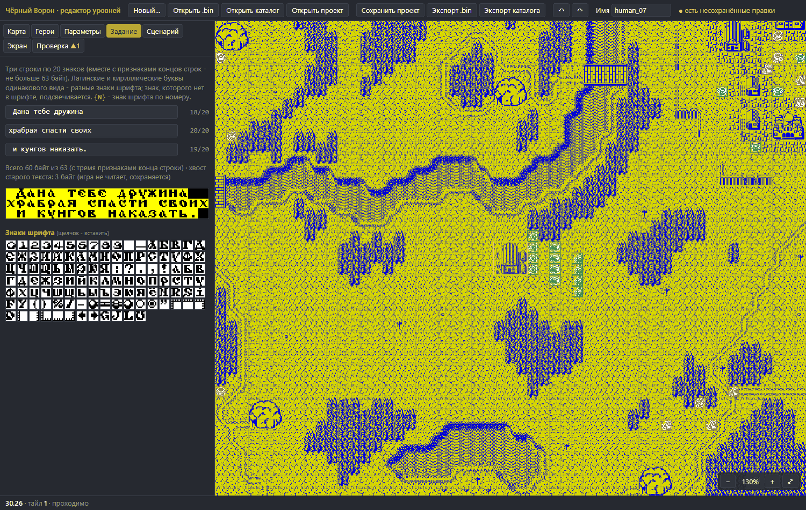</td><td>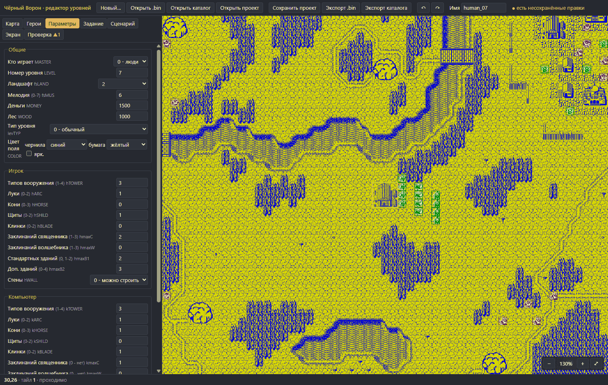</td></tr>
<tr><td align="center">Задание шрифтом игры</td><td align="center">Параметры</td></tr>
<tr><td>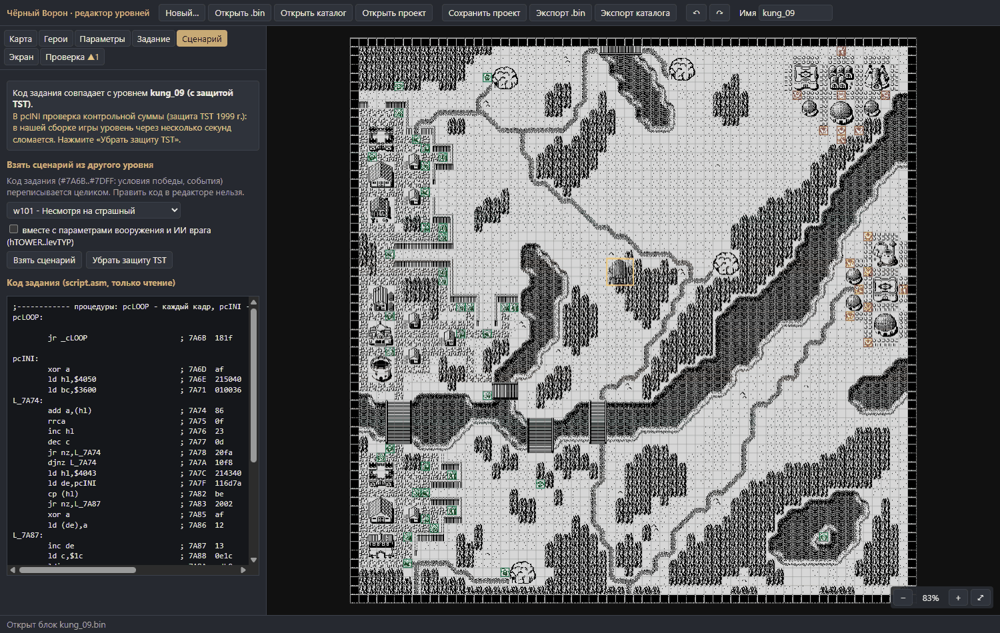</td><td>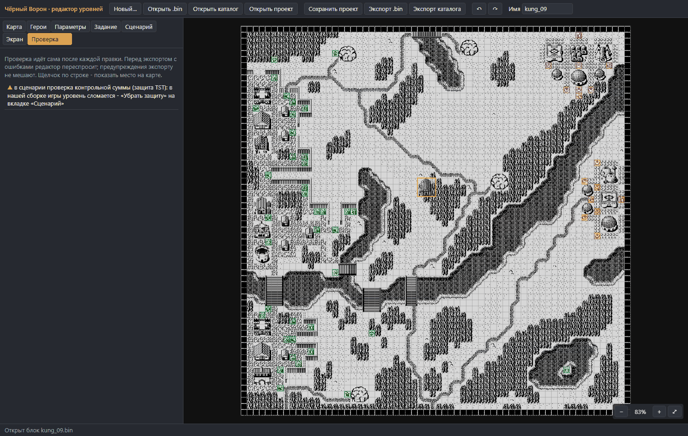</td></tr>
<tr><td align="center">Сценарий</td><td align="center">Проверка</td></tr>
<tr><td>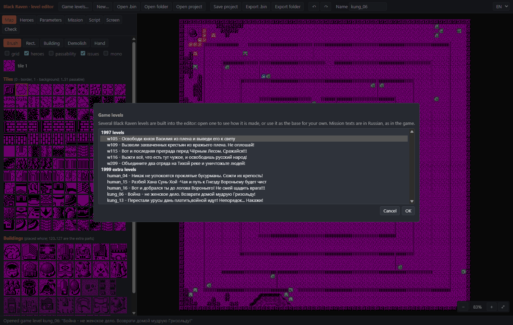</td><td>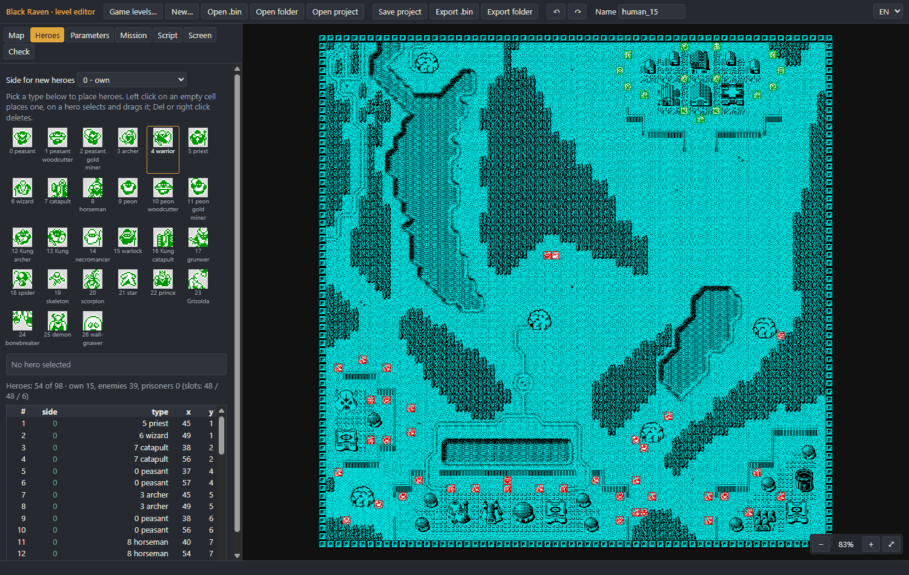</td></tr>
<tr><td align="center">Встроенные уровни игры</td><td align="center">English interface</td></tr>
<tr><td colspan="2">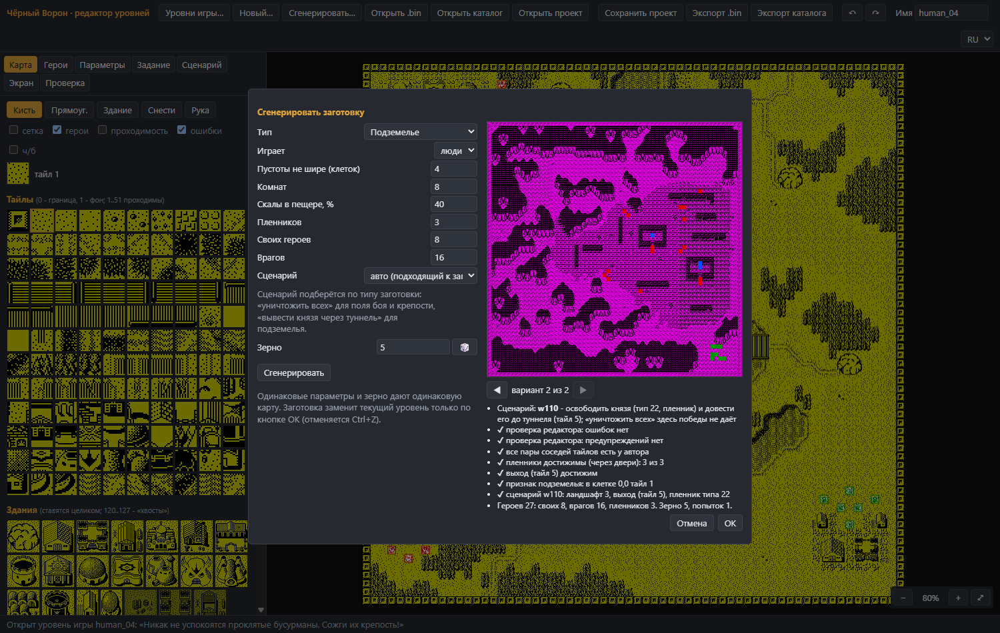</td></tr>
<tr><td colspan="2" align="center">Генератор заготовок</td></tr>
</table>

**Форматы.** Редактор открывает и сохраняет блок уровня `.bin` (12608 байт), каталог уровня в формате `assets_src/levels_ext/`
и собственный проект `.json`. Перевод в любую сторону проверен тестом на 66 блоках уровней игры: файлы совпадают побайтно.

---

## Подробно

Редактор блоков уровней в нынешнем формате игры (LEVDAT=#79C0, 12608 байт; см. `docs/FORMATS.md`, п. 4 «Карты и герои уровней» и «Блок уровня»).
Работает в браузере без сервера и без сборки: всё - обычные HTML/JS.

## Запуск

Открыть `editor/index.html` в Chrome, Edge или другом браузере на Chromium (двойной щелчок, `file://`).
Firefox и Safari тоже откроют, но «Экспорт каталога» там сохраняет `.zip` (нет записи в каталог), а «Открыть каталог» зависит от поддержки выбора каталога.

Если браузер не пускает `file://`, можно поднять крошечный сервер:

```
python -m http.server 8000 --directory editor
```

и открыть `http://localhost:8000/`.

## Что умеет

* **Уровни игры**: 5 уровней 1997 г. и 5 доп. уровней 1999 г. встроены в `data/brdata.js` целиком (выбраны случайно, но постоянно - `SEED`
  в `tools/make_data.py`); при запуске открывается один из них.
* **Язык**: русский / английский (`js/i18n.js`; `?lang=en` в адресе, иначе выбранный ранее, иначе язык браузера). Задание и файлы уровня
  (`script.asm`, `heroes.txt` и т. д.) не переводятся - это данные игры.
* **Открыть**: блок `.bin` (12608 байт: `reference/cs1999/levels_ext/*.bin`, `build/two/levels/1NN.bin`, `build/levels_ext/*.bin`), каталог уровня в формате
  `assets_src/levels_ext/<имя>/` (можно выбрать и сам `levels_ext` - редактор спросит, какой уровень), проект редактора `.json`. «Новый…» - пустая карта
  (фон 1, граница 0) со сценарием и параметрами выбранного уровня.
* **Карта 64x64** настоящими тайлами выбранного ландшафта (`w<L>spr.dat`) в цвете поля уровня (`COLOR`; есть ч/б). Кисть, прямоугольник, ПКМ - взять тайл/здание с карты.
  **Здания ставятся целиком**: центр и «хвосты» 120..127 пишутся сами (3x3 - центры 78..107, 2x2 - 108..112, центр - правый нижний угол); кисть по любой части
  здания сносит его целиком, «Снести» - убрать здание. Бледные здания в палитре в картах игры не встречаются (графика может быть неудачной).
  Колесо - масштаб, средняя кнопка / пробел + ЛКМ / «Рука» - сдвиг, `0` - вся карта. Слои: сетка, герои, проходимость (непроходимое красным), ошибки.
* **Герои** настоящими спрайтами (`wshum`, `wsorc`, `wscreat1`, `wscreat2`, как `tools/maps.py`), рамка по стороне: свои (раса игрока) зелёные, враги красные, пленники синие.
  Поставить, выбрать, перетащить, удалить (Del, ПКМ), сменить тип/сторону/координаты; список героев; не больше 98.
* **Параметры** формой: кто играет, номер, ландшафт, мелодия, деньги, лес, тип уровня, цвет поля, вооружение и заклинания игрока и компьютера,
  поведение врага, золото 8 шахт (`datMIN`).
* **Задание**: 3 строки, счётчик знаков (20 в строке) и байтов (всего 63 вместе с тремя кодами конца строки), подсветка знаков, которых нет в шрифте,
  предпросмотр шрифтом игры (`wfont.fnt`), таблица всех знаков шрифта (латинские и кириллические буквы одного вида - разные знаки; `{N}` - знак по номеру).
  «Хвост» старого текста за третьей строкой сохраняется, как в `tools/levels.py`.
* **Сценарий** (код задания Z80) не правится. Можно только **взять сценарий из другого уровня** (34 уровня 1997 г. и 32 доп. уровня 1999 г.; по желанию - вместе с
  параметрами вооружения и ИИ) и **убрать защиту TST** (как `levasm.clean`). Код показывается дизассемблированным (`script.asm`, только чтение).
* **Экран**-заставка: просмотр и замена (`.scr` или PNG 256x192; PNG приводится к цветам Спектрума, как `gfx.scr_color_import`).
* **Проверка** (сама, после каждой правки; щелчок - показать место): граница карты, целостность зданий (каждый хвост указывает на центр, у здания все части,
  не у края), число героев (98; по сторонам 48 / 48 / 6), герои на непроходимых клетках (проходимы тайлы 1..51 - `go_Max` в `wlib1a.asm`) и в одной клетке,
  задание (длина, знаки шрифта), значения параметров, защита TST. Ошибки перед экспортом показываются, экспорт всё же возможен по подтверждению.
* **Сохранить**: проект `.json` (всё состояние, включая исходный `script.asm`), **экспорт `.bin`** (12608 байт), **экспорт каталога** для
  `assets_src/levels_ext/` (`script.asm`, `task.txt`, `map.csv`, `heroes.txt`, `screen.png` + `screen.orig.scr`, `preview.png`; у уровней с защитой - и `script.orig.asm`,
  пока сценарий не меняли). В Chrome/Edge выбирается каталог (например, `assets_src/levels_ext`), в нём создаётся/перезаписывается `<имя>/`; иначе - `.zip`.
  Отмена/возврат - Ctrl+Z / Ctrl+Y.
* **Умные кисти** - см. ниже: «Дорога» (D), «Река» (W), «Покрытие» (F), «Перерисовать» (G).

## Умные кисти

Кисть задаёт только **смысл** клеток: здесь дорога, здесь вода, здесь лес. Тайлы подбирает сам редактор, тем же WFC, что и генератор заготовок,
и по тем же парам соседей, выученным на 64 картах игры. Поэтому повороты, развилки, берега, углы и мосты выходят «родными».

* **Дорога** (D): ведите ЛКМ - дорога пойдёт по клеткам штриха. Через воду ставится прямой мост в 3 клетки шириной, как у автора: редактор сам ищет
  место рядом со штрихом (сдвиг вдоль берега до 3 клеток), где берега ровнее, и выравнивает берег у концов моста. Мост длиннее 12 клеток не ставится.
  ПКМ - стереть дорогу (мост снова становится водой).
* **Река** (W): ширина 3, 4 или 5 клеток. **Уже 3 клеток реки у автора не бывает** - у него два береговых тайла никогда не стоят рядом, так что
  речка в 1-2 клетки из его тайлов не собирается. Берега и повороты подбираются сами; новая вода берёт ту же текстуру, что и вода, в которую она
  впадает (у автора в одном водоёме текстуры не смешиваются). Река через дорогу ставит мост; старые мосты не трогает. ПКМ - стереть воду
  (мосты на стёртом месте становятся дорогой).
* **Покрытие** (F): лес (на ландшафте 2 - скалы), площадь людей, площадь кунгов; в подземелье - скала, стена, светлый пол пещеры, серый пол зала.
  Ширина 1..5. ПКМ - стереть это покрытие (станет травой, в подземелье - светлым полом). Дорог и рек в подземелье нет - там их кнопки скрыты.
* **Перерисовать** (G): протяните прямоугольник - тайлы в нём (и в 2 клетках вокруг, чтобы сошлись края) подберутся заново, а смысл клеток останется прежним (трава травой, вода водой).
* **Ещё вариант** - тот же штрих с другим подбором тайлов (заменяет последний штрих, а не добавляет новый). Каждый штрих - одно действие для Ctrl+Z.

Что гарантируется и чего нет:
* пар соседних тайлов, которых нет у автора, кисть не добавляет (проверяется тестом на каждом штрихе);
* здания, ограды, площадки баз (если рисуется не площадь), двери, выход, рамка карты и мосты, которых штрих не касается, не меняются;
  дорога у них обрывается, вода обходит их на клетку;
* тайлы меняются только в полосе вокруг штриха (обычно 2 клетки, при трудностях до 6) и у моста;
* у леса рядом с новой дорогой или водой прорубается полоса травы в клетку - так у автора;
* если в каком-то месте тайлы автора не сходятся (дорога вплотную к другой дороге, перекрёсток «+», которого у автора нет, косой стык с
  рекой), эти несколько клеток остаются прежними, а строка внизу честно пишет, сколько их; в тестах это в среднем 3-4 клетки на штрих;
* если вода залила клетку с героем, строка внизу об этом предупреждает (и «Проверка» покажет его).

## Генератор заготовок

Кнопка **«Сгенерировать…»**. Она делает **заготовку**: хорошую основу уровня, которую дальше дорисовывают руками. Это не готовый сбалансированный
уровень. Результат — обычный уровень редактора: правится, проверяется и экспортируется, как любой другой.

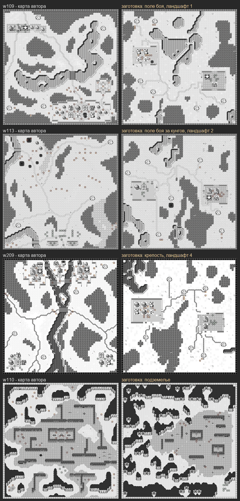

**Как пользоваться.** В окне выберите тип, ландшафт и кто играет (люди или кунги), задайте параметры и нажмите «Сгенерировать». Справа появятся
предпросмотр и отчёт проверок.
- 🎲 даёт случайное зерно; одинаковые параметры и зерно дают одинаковую карту;
- «◀ ▶» листают последние 30 вариантов этого сеанса, вместе с параметрами;
- OK заменяет текущий уровень, и Ctrl+Z возвращает прежний.

**Типы заготовок.**
* **Поле боя** (ландшафты 1, 2, 4).
  * Базы людей и кунгов на заданном расстоянии: площадь, ограда с воротами, здания своей расы.
  * Шахты: у каждой базы и между базами, всего не больше 8. Пустым шахтам дано золото, как у уровня-образца.
  * Вода — по шуму высоты, лес и скалы — по шуму влажности.
  * **Преграды**: полосы леса или воды поперёк линии баз во всю карту, с проходами в стороне от прямой. Если путь всё равно идёт почти
    напрямую, заготовка бракуется.
  * **Пустоты**: в самое дальнее от всего место ставится шахта, роща или озеро, пока не останется пустых мест шире заданного.
  * Тропа от базы к базе и ветки к шахтам. Свои — у своей базы, враги — у вражеской и у шахт.
* **Крепость** (смешанный тип). То же поле боя, но база врага больше, обнесена оградой с одними воротами, в ней больше зданий,
  охрана и пленники.
* **Подземелье** (ландшафт 3).
  * Неровный зал серого пола, в нём отдельные стены, Г- и П-образные постройки и полукомнаты.
  * Камеры с пленниками: коробка с дверью, которую можно сломать; у двери охрана.
  * Скалы — клеточным автоматом, вокруг и внутри.
  * Свои — в пещере подальше от выхода. Выход — туннель, тайл 5 в южной грани скалы.
  * В клетке 0,0 ставится тайл 1 — признак подземелья для игры (`wlib1a.asm typMAP`).

**Как это устроено: два слоя.**
1. **Слой смыслов** — сетка классов 64×64: трава, вода, лес, площадь базы, здание, пол, стена, скала, выход и т. д.
2. **Слой тайлов** — Wave Function Collapse по парам соседей, **выученным на 64 картах игры**.
   * В клетке класса K допустимы только тайлы класса K.
   * Пара соседей допустима, только если она встречалась у автора.
   * Вариант тайла выбирается по частоте у автора в таком же окружении классов.
   * Поэтому берега, края скал, углы стен и ограды получаются «родными».
   * При противоречии сбрасывается растущий квадрат вокруг него. Если не помогает, класс в этом месте ослабляется (кроме зданий, дверей и
     выхода). Если не помогло и это — новая попытка с другим внутренним зерном.
   * Здания ставятся целиком функцией редактора; в слое тайлов здание — один условный тайл.

**Обучение и разметка тайлов** — `python editor/tools/make_gen.py`, результат — `data/gendata.js`.
* Ручная основа классов — по `docs/FORMATS.md` п. 2.2 (WLAND.CPP), отдельно для «наружных» ландшафтов и для подземелья.
* Остальные тайлы размечаются автоматически: вектор соседей по 4 сторонам, k-средних по косинусной близости, голос соседей,
  проходимость и доля чернил.
* Для каждого тайла определяются переходы: с какой стороны преобладает другой класс.
* Тайлы, которые встречаются у автора реже 4 раз, в генерацию не идут.
* Таблицы `data/tile_classes_<L>.json` правятся руками. Если поле `class` отличается от `auto`, правка считается ручной и при пересборке сохраняется;
  `"use": false` выключает тайл.
* Лист для проверки глазами — [`data/tile_classes.html`](data/tile_classes.html): картинки тайлов по классам, частоты, переходы и несогласия
  автоматики с ручной разметкой.

**Сценарий.** Код задания не генерируется: генератор берёт сценарий уровня игры и выполняет его ожидания. `make_gen.py` разбирает код
заданий всех 64 уровней. TheEND=1 — всегда победа игрока, 2 — поражение (`wmenu2.asm MU_END`). Массив HUMAN — войска игрока, туда же
переходят освобождённые пленники; KUNGE — враг.

| Цель | Уровни | Что зашито | Заготовки |
|---|---|---|---|
| уничтожить всех (END_1) | 50 уровней, в т. ч. w113, w114, w208, human_14 с посторонним кодом | ничего | поле боя, крепость |
| князь (22) или Гризольда (23) дошли до туннеля (END_2) | w105, w110 (люди), w206, w212 (кунги) | тайл 5, пленник 22/23, ландшафт 3, MAP[0]=1 | подземелье (по умолчанию) |
| свой герой типа T в клетке x,y | human_10 (22: 60,26), kung_12 (23: 33,27), kung_06 (23: 2,4), kung_01 (9/10: 1,62) | координаты и тип | подземелье — выход ставится ровно в эту клетку; поле боя — клетка проверяется на достижимость |
| построить 7 зданий с центром 86 | w101, human_01 | тип и число | поле боя людей |
| разрушить здание кунгов | human_04 (101), human_06 (102), human_16 (107) | тип здания | поле боя людей — генератор ставит это здание в базу врага |
| убить вражеского князя | kung_15 | тип 22 в массиве врага | поле боя кунгов — князь у вражеской базы |

Сценарий подбирается сам («уничтожить всех» для поля боя и крепости, «туннель» для подземелья) или выбирается из списка подходящих.
Ожидания выбранного сценария проверяются; заготовку, где они не выполнены, генератор не выдаёт. Сценарий не из списка тоже можно выбрать —
тогда отчёт честно пишет, что его ожиданий генератор не знает.

**Что гарантируется** (проверяется у каждой заготовки; если не прошло — новая попытка):
* «Проверка» редактора без ошибок;
* все пары соседних тайлов есть у автора;
* базы соединены проходимым путём, все враги достижимы;
* в подземелье пленники и выход достижимы от своих (двери ломаются);
* лимиты героев соблюдены: всего 98, по сторонам 48 / 48 / 6; герои стоят только на проходимых клетках (1..51);
* ожидания сценария выполнены.

**Проверено в игре.** Заготовки всех трёх типов, за людей и за кунгов, собраны во временной копии игры (`build.py`) и запущены в эмуляторе.
Уровень загружается, герои ходят. Условия «уничтожить всех», «князь в туннеле» и «точка 60,26 из human_10» дают экран «Победа! Задание выполнено!».

## Как уровень попадает в игру

`build.py` берёт доп. уровни из `assets_src/levels_ext/` **по именам** `human_01`..`human_16` и `kung_01`..`kung_16`. Чтобы проверить свой уровень в игре,
экспортируйте каталог под одним из этих имён (поле «Имя» вверху) в `assets_src/levels_ext/` и выполните `python build.py`. Уровни 1997 г. в `src/levels/`
редактор не переписывает: их можно открыть (`build/two/levels/1NN.bin`) и сохранить как доп. уровень.

## Устройство

```
editor/index.html, css/, js/app.js   интерфейс
editor/js/core.js                    модель уровня и форматы (без DOM; тот же код проверяется в node)
editor/js/i18n.js                    язык интерфейса: английский перевод (ключ - русский текст)
editor/js/gen.js                     генератор заготовок и умные кисти (без DOM): общая часть (RNG, шум, модель соседей, WFC) + планы BR1 (поле боя, крепость,
                                     подземелье) + brushStroke (дорога, река, покрытие, перерисовать)
editor/data/gendata.js               выученное на картах игры: классы тайлов, пары соседей, контексты, герои, здания, разбор сценариев (создаётся)
editor/data/tile_classes_<L>.json    разметка тайлов по классам (правится руками); tile_classes.html - лист для проверки глазами
editor/tools/make_gen.py             обучение генератора -> gendata.js, tile_classes_*.json, tile_classes.html
editor/data/brdata.js                графика ландшафтов и героев, шрифт, таблица глифов, библиотека сценариев (создаётся, не править)
editor/tools/make_data.py            пересоздать brdata.js из assets_src и src/levels (после правок графики или сценариев)
editor/tools/brlib.py                общее для инструментов: ресурсы во временный каталог, сборка блоков 1997 г. sjasmplus
editor/test/run_tests.py             проверка (ниже); test/roundtrip.js - её часть на node
editor/test/i18n_check.py            все русские строки интерфейса есть в переводе
editor/test/gen_test.js              генератор: детерминизм, 110 зёрен каждого типа, экспорт
editor/test/brush_test.js            умные кисти: мосты, штрихи по уровням игры, покрытие, стирание, перерисовка
```

Модель уровня (`core.js`) - обычный объект `{name, script(1104 байта), task, heroes[], map(4096), screen(6912), asmText}`; блок `.bin`, каталог и проект -
три способа его записать. Параметры читаются и пишутся по смещениям в `script`, так что неизвестные байты сохраняются как есть. Для будущих файлов-кампаний
(заголовок + уровни, графика, музыка, языки) достаточно добавить ещё один способ записи, модель менять не нужно.

`make_data.py` нужен Python 3, Pillow и `sjasmplus` (как и сама сборка); собирает ресурсы `assets_src` во временный каталог, `build/` не трогает:

```
python editor/tools/make_data.py
```

## Проверка

```
python editor/test/run_tests.py
```

(нужны Python 3, Pillow, `sjasmplus`, node 18+). Что проверяется:

1. все 34 блока `reference/cs1999/levels_ext/*.bin` и 32 уровня 1997 г. (собираются из `src/levels` и `assets_src`): открыть -> сохранить `.bin` - побайтно то же;
   проект `.json` туда и обратно; экспорт в каталог -> открыть каталог редактором -> тот же блок;
2. 32 каталога `assets_src/levels_ext/*`: открыть -> блок равен тому, что собирает `tools/levels.py`; при экспорте `script.asm`, `script.orig.asm`, `task.txt`,
   `map.csv`, `heroes.txt` не меняются;
3. `python tools/levels.py import --src <экспорт редактора> --out <tmp>` собирает из всех 66 каталогов ровно исходные блоки;
4. уровни с правками (деньги, лес, музыка, шахта, задание, герои, тайл, здания 3x3 и 2x2, снятая защита, сценарий из другого уровня - в т. ч. 1997 <-> 1999,
   новый уровень, неизвестный код): блок редактора = блок, который `tools/levels.py` собирает из экспортированного каталога;
5. встроенные уровни игры открываются и сохраняются побайтно; у каждой русской строки интерфейса есть английский перевод;
6. генератор (`test/gen_test.js`):
   * детерминизм по зерну;
   * по 110 зёрен поля боя, крепости и подземелья (ландшафты 1/2/4, люди и кунги, сценарии с зашитыми координатами). Для каждой
     заготовки заново пересчитываются «Проверка» без ошибок, связность, достижимость пленников и выхода, пары соседей;
   * экспорт `.bin` и каталога читается обратно; каталоги заготовок принимает `tools/levels.py import`, и собранные им блоки совпадают с блоками редактора;
7. умные кисти (`test/brush_test.js`):
   * мост: на чистой карте через прямую реку шириной 3/4/5 на ландшафтах 1/2/4, поперёк и вдоль - мост 3 клетки поперёк, без потерь;
   * 150 штрихов «как рукой» (дорога, река, стирание) и 60 штрихов «Покрытием» по всем встроенным уровням, в том числе в подземелье: детерминизм,
     карта уровня не портится, новых пар соседей не из статистики автора нет, здания и ограды не тронуты, всё изменённое - рядом со штрихом,
     «Проверка» не даёт новых ошибок, клеток штриха, оставшихся прежними, в среднем не больше 5;
   * стирание дороги тем же штрихом; «Перерисовать» на всех встроенных уровнях сохраняет классы клеток и признак подземелья.

## Ограничения

* Код задания (Z80) не редактируется - только «взять из другого уровня» и «убрать защиту». Свой сценарий - правкой `script.asm` руками и сборкой игровыми средствами.
* Открывая каталог, редактор **не ассемблирует** `script.asm`: машинный код команд берётся из комментариев дизассемблера (`; 7A6B  1801`), параметры и
  данные (`DEFB/DEFW/DEFS/INCBIN "task.bin"`) разбираются честно. Если `script.asm` правили руками (сменили команду, а комментарий остался старым,
  или дописали команду без комментария), откройте вместо каталога блок, собранный `python tools/levels.py import --src <каталог> --out <tmp>`.
* Если код задания не найден в библиотеке (не из игры), экспортированный `script.asm` записывает его байтами (`DEFB`) - собирается в те же байты, но без мнемоник.
* Экспорт каталога не удаляет в нём лишние файлы (например, `script.orig.asm` после смены сценария останется от старого уровня - сборке он не мешает).
* Названия части типов героев (1, 2, 9-17) даны по ролям в `wmisc_1.asm` и по картинкам, не проверены в игре. Сторона героя 3 - пленники в уровнях кунгов
  (так в данных 1999 г.; игра кладёт все стороны >= 2 в массив пленников).
* Проходимость - только по номеру тайла (1..51); занятость клеток зданиями, водой и т. п. игра считает так же, но других правил (например, шахт) редактор не знает.
* Экраны: редактор их показывает и заменяет целиком, но не рисует.
* Сторона героя в файле — это **раса**: 0 люди, 1 кунги, 2/3 пленники (`wmisc_1.asm NEWALL`: массив = MASTER xor сторона). «Свои» — раса игрока:
  в уровнях кунгов свои — сторона 1. Редактор так и показывает (свои зелёные). Комментарий в `heroes.txt` («0 - свои, 1 - враги») пишется так же, как у `tools/maps.py`.
* Генератор:
  * карта игры всегда 64×64;
  * задание генерируется короткое и общее — его надо переписать;
  * экран-заставка чёрный;
  * мостов через воду нет: проход — сухая полоса;
  * «перегенерировать выделенную область» пока нет;
  * баланс сил не подбирается;
  * часть типов героев не используется (катапульты, роли крестьян);
  * на ландшафте 2 класс «лес» — это скальные гряды, на 1 и 4 — лес.
